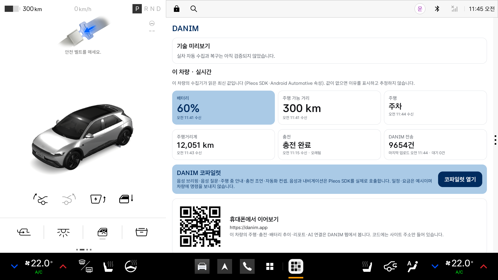
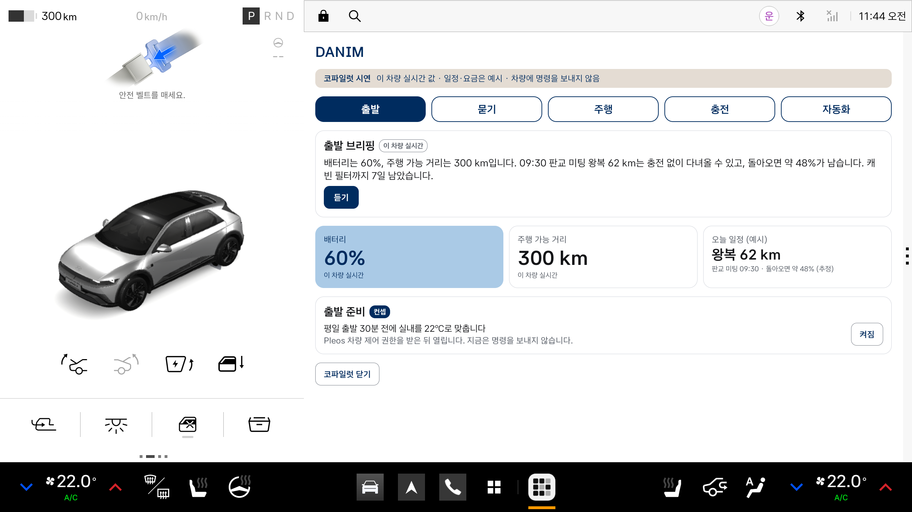
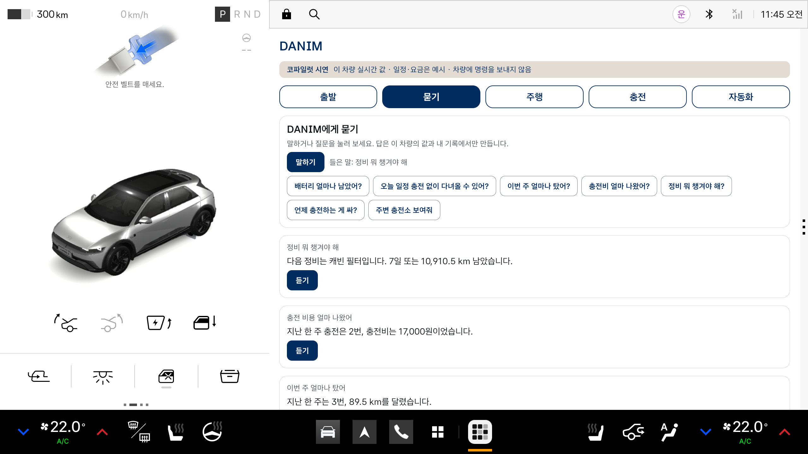
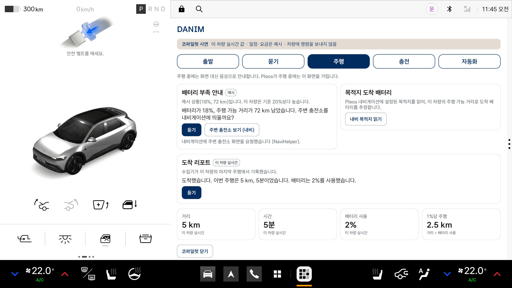
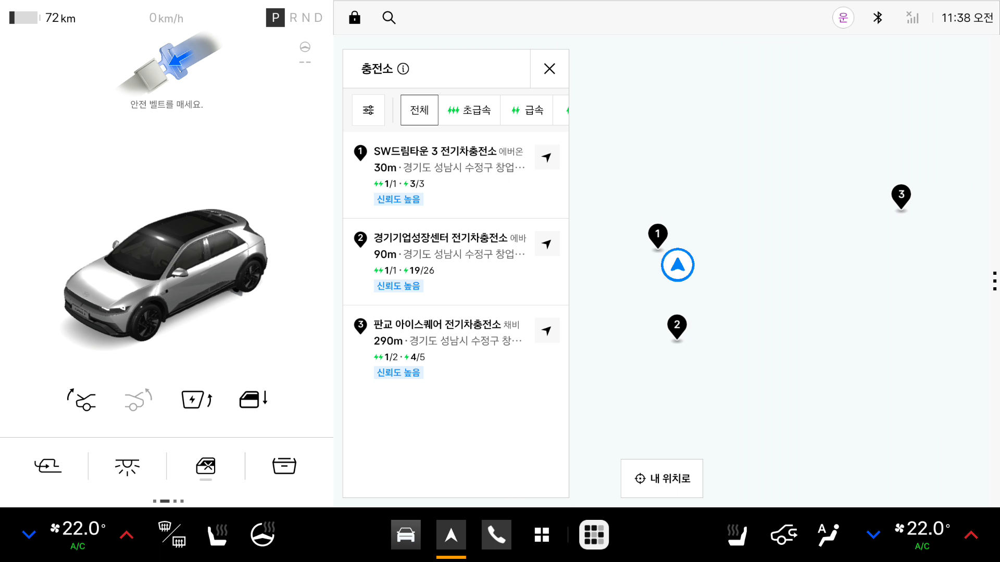
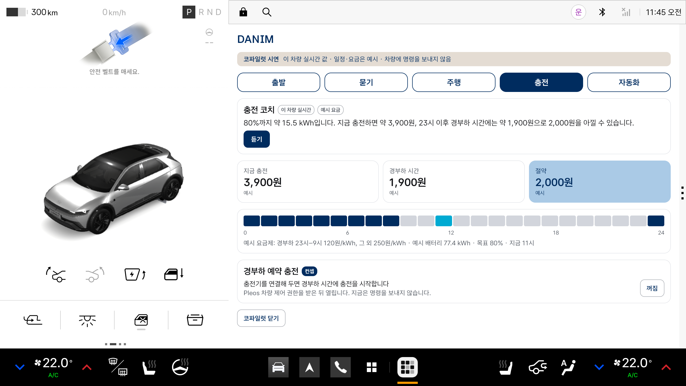
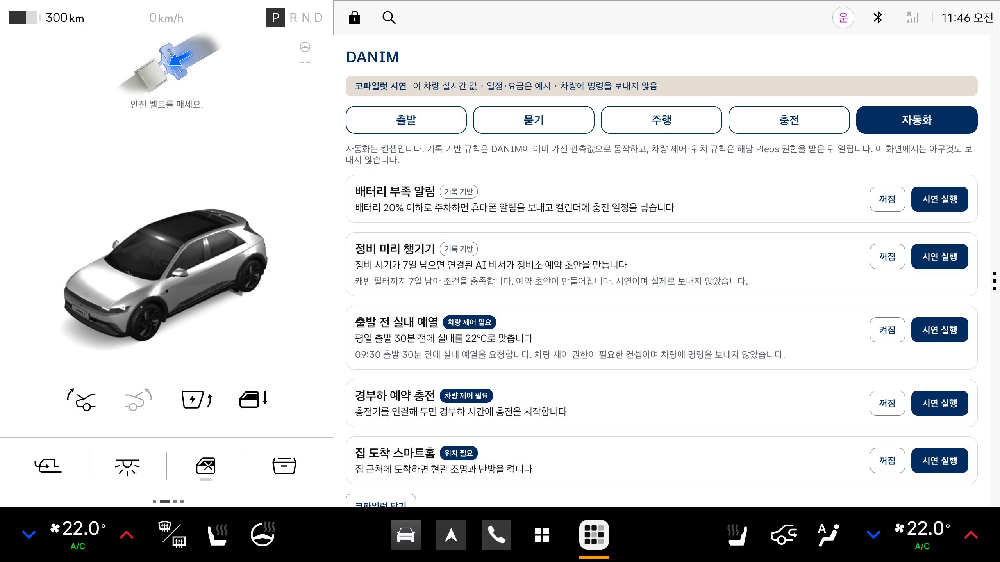
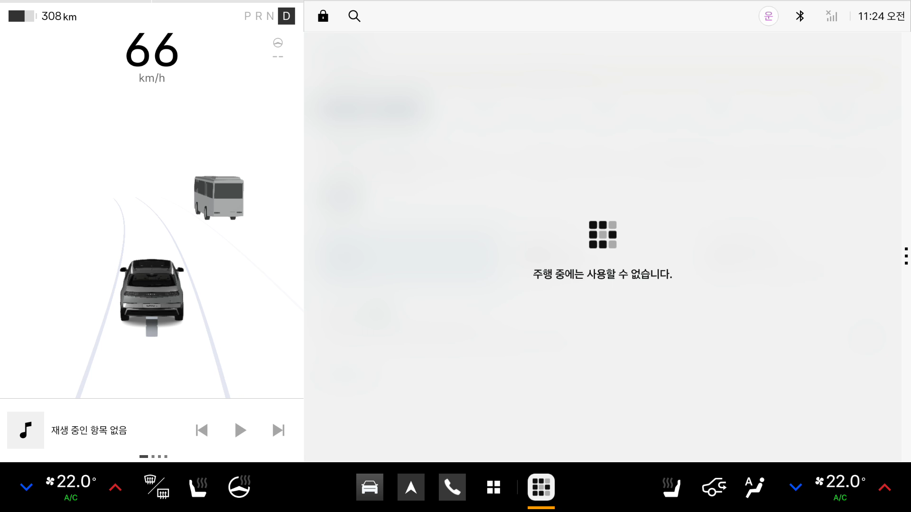
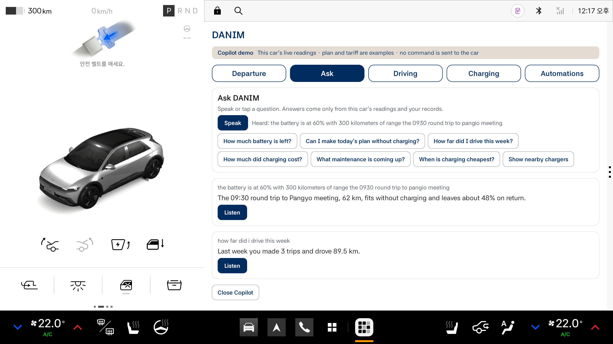

# 1. 앱 개발 내용과 UI/UX

DANIM은 Pleos Connect 차량에서 동작하는 Kotlin·Jetpack Compose 앱입니다(minSdk 28, targetSdk 34). 차량이 보고한 값을 읽기 전용으로 수집하고, 그 기록으로 계산한 답을 차 안의 순간마다 음성으로 알려 줍니다.

표기: **[확인]** 은 공식 Pleos Connect 2.1 에뮬레이터에서 실제 SDK 호출로 동작을 확인한 것, **[예시]** 는 화면에 예시로 표시된 고정 값, **[컨셉]** 은 아무것도 보내지 않는 체험 화면입니다.

## 구조

```
Pleos 차량 (Vehicle SDK, CarPropertyManager)
        │ 읽기 전용 수집
        ▼
DANIM 차량 앱 ── 코파일럿: 의도 분류 → 기록에서 계산 → 정해진 문장
        │            │ TextToSpeech / SpeechToText / NaviHelper / Gleo Interface
        │ 관측값 업로드 (차량 전용 자격 증명)
        ▼
Danim.app (웹·모바일) ── MCP (OAuth, 소유자 동의·철회) ── ChatGPT · Claude
```

- 차 안의 답변은 생성형 모델이 아닌 결정적 로직입니다. 질문을 키워드로 8개 의도 중 하나로 분류하고, 차량 실시간 값과 기록에서 값을 계산해 정해진 문장으로 답합니다. 기록에 없는 질문에는 답을 지어내지 않습니다.
- 답마다 출처(이 차량 실시간 값 / 고정 시연 기록 / 예시)를 붙이고, 차량이 보내지 않은 값은 0으로 채우지 않고 "알 수 없음"으로 말합니다.
- 생성형 AI는 차 밖에서 MCP로 연결되며 도구가 돌려준 값만 사용합니다. 서버와 웹의 소스는 이 저장소에 포함하지 않았습니다.

## SDK가 쓰이는 곳

| SDK | 소스 | 하는 일 |
| --- | --- | --- |
| Vehicle 2.3.2 | [`collector/VehicleSignalSource.kt`](../apps/automotive/app/src/main/kotlin/app/danim/automotive/collector/VehicleSignalSource.kt) | 주행거리계·EV 배터리·연료 값 |
| CarPropertyManager | [`collector/AaosPropertySource.kt`](../apps/automotive/app/src/main/kotlin/app/danim/automotive/collector/AaosPropertySource.kt) | 속도·기어·충전 상태·주행 가능 거리·시동 |
| TextToSpeech 3.3.1 | [`voice/PleosVoice.kt`](../apps/automotive/app/src/main/kotlin/app/danim/automotive/voice/PleosVoice.kt) | 브리핑·답변·도착 리포트·배터리 안내 |
| SpeechToText 3.3.1 | [`voice/PleosEar.kt`](../apps/automotive/app/src/main/kotlin/app/danim/automotive/voice/PleosEar.kt) | 음성 질문 인식 |
| NaviHelper 3.0.5 | [`nav/PleosNavi.kt`](../apps/automotive/app/src/main/kotlin/app/danim/automotive/nav/PleosNavi.kt) | 주변 충전소 화면, 목적지 정보 |
| Gleo Interface | [`assets/schema.json`](../apps/automotive/app/src/main/assets/schema.json), [`gleo/GleoReceiver.kt`](../apps/automotive/app/src/main/kotlin/app/danim/automotive/gleo/GleoReceiver.kt) | 읽기 전용 함수 3개와 응답 |

코파일럿의 계산 로직은 순수 Kotlin 모듈에 있습니다: [`core/copilot/Copilot.kt`](../apps/automotive/core/src/main/kotlin/app/danim/core/copilot/Copilot.kt). 단위 테스트는 core 220개, app 21개이며 이 저장소만으로 통과합니다.

네 SDK는 하나라도 빠지면 핵심 경험이 성립하지 않습니다. Vehicle SDK가 없으면 답할 값이, TextToSpeech·SpeechToText가 없으면 화면 없이 주고받을 수단이, NaviHelper가 없으면 답에서 충전소로 이어지는 행동이 사라집니다.

## 주요 기능

1. **도착 리포트 (자동 발화)**: P단에 넣으면 방금 주행의 거리·시간·배터리 사용량·1%당 주행 거리를 조작 없이 말합니다. [확인]
2. **배터리 부족 안내 → 충전소 (자동 발화)**: 배터리가 20% 이하가 되는 순간 잔량과 주행 가능 거리를 한 번만 말하고, '주변 충전소' 버튼은 Pleos 내비게이션의 충전소 목록을 엽니다. [확인 / 목적지 연동은 '목적지 없음' 응답까지 확인]
3. **출발 브리핑**: '듣기'를 누르면 실시간 배터리·주행 가능 거리로 오늘 일정을 충전 없이 다녀올 수 있는지 계산해 다음 정비와 함께 말합니다. [확인 / 예시: 일정]
4. **음성 질문**: 배터리, 오늘 일정, 주간 주행, 충전비, 정비, 충전 시점, 최근 주행, 주변 충전소 8가지 주제를 한국어와 영어로 묻고 듣습니다. [확인]
5. **충전 코치**: 80%까지 필요한 전력량과 비용을 지금 요금과 경부하 시간 요금으로 비교합니다. [확인 / 예시: 요금제·배터리 용량 / 컨셉: 예약 충전 실행]
6. **자동 주행·충전 기록**: 수집한 관측값을 계정에 올리고, 서버가 관측값만으로 주행·충전 세션을 도출해 Danim.app에 보여 줍니다. [확인: 에뮬레이터 관측값으로 차량 앱 → 서버 → 웹]
7. **AI 연결**: 차 밖에서는 MCP로 ChatGPT·Claude가 허용된 기록만 읽고, 차 안에서는 Gleo용 App Schema에 함수 3개를 등록했습니다. [확인: MCP 실제 호출, 에뮬레이터의 Gleo AI가 스키마를 읽고 응답을 수신 / 미확인: 운전자의 음성 호출 전체 경로]
8. **자동화**: 기록 기반 규칙과 차량 제어·위치 규칙을 미리 체험합니다. [컨셉: 아무것도 보내지 않음]

## UI/UX 설계

차량 화면(2560 × 1440, 가로)과 주행 맥락에 맞춘 원칙입니다.

- **주행 중에는 화면을 요구하지 않습니다.** Pleos 정책에 따라 주행 중 앱 화면이 가려지므로 DANIM은 기록만 계속하고, 안내는 짧은 음성 한 번으로 제한합니다. 배터리 안내는 기준을 넘는 순간 1회만 말합니다.
- **화면 조작은 주차·정차 중에만.** 큰 글자와 큰 버튼, 한 화면에 한 가지 일, 다섯 개의 탭(출발·묻기·주행·충전·자동화)으로 구성했습니다.
- **출처가 항상 보입니다.** 값 옆에 '이 차량 실시간', '고정 시연 기록', '예시' 표시를 붙였습니다.
- **모르는 값은 모른다고 표시합니다.** 제공되지 않거나 권한이 없는 신호는 "미지원"·"권한 거부"로 그대로 보여 줍니다.
- **음성 안내는 동승자도 함께 듣습니다.** 화면을 보지 않아도 같은 정보를 공유합니다.
- **한국어와 영어**를 시스템 언어에 따라 화면과 음성 모두에 적용합니다.

| 화면 | 스크린샷 |
| --- | --- |
| 실시간 대시보드 (페어링 후) |  |
| 코파일럿: 출발 브리핑 |  |
| 코파일럿: 음성 질문 |  |
| 코파일럿: 주행·도착 리포트 |  |
| Pleos 내비게이션의 주변 충전소 (NaviHelper) |  |
| 코파일럿: 충전 코치 |  |
| 코파일럿: 자동화 컨셉 |  |
| 주행 중 화면 가림 (Pleos 정책) |  |
| 음성 질문 (영어) |  |

계정 없이 열리는 고정 기록 화면(상태·주간 보고·정비·연결·로드맵)은 [`screenshots/car/`](screenshots/car)의 09~13번에 있습니다.

## 권한과 보안

- 문서의 일반 권한만 선언합니다. PRIVATE 권한, 차량 제어, 위치 코드는 없습니다.
- 음성은 온디바이스 모드라 Pleos 클라이언트 시크릿을 APK에 넣지 않으며, 음성 인식 결과는 저장하거나 서버로 보내지 않습니다.
- 차량에는 페어링 때 발급한 차량 전용 자격 증명만 저장합니다.

## 아직 확인하지 않은 것

실차 동작, Gleo 음성 호출의 전체 경로(Pleos 스키마 검토 필요), 사람의 육성으로 한 음성 질문(시험 입력은 합성 음성), 주행 중 화면이 가려진 상태에서의 배터리 안내 발화.
