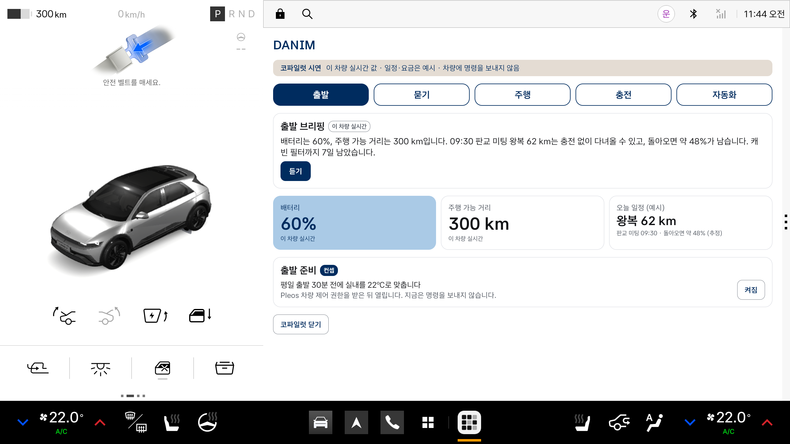
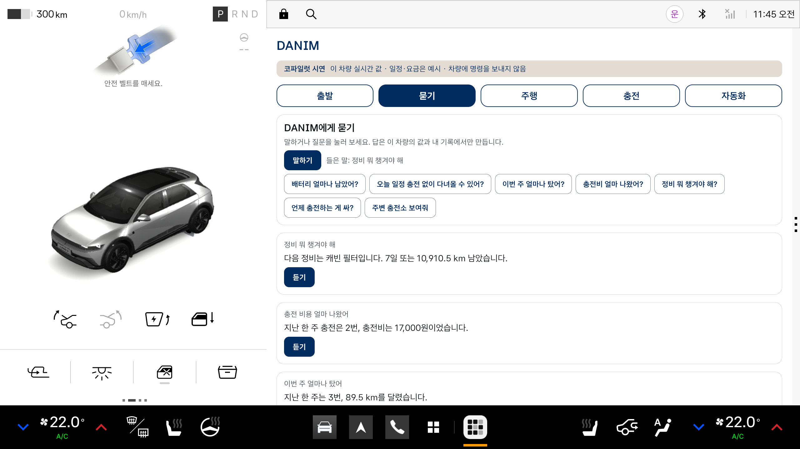
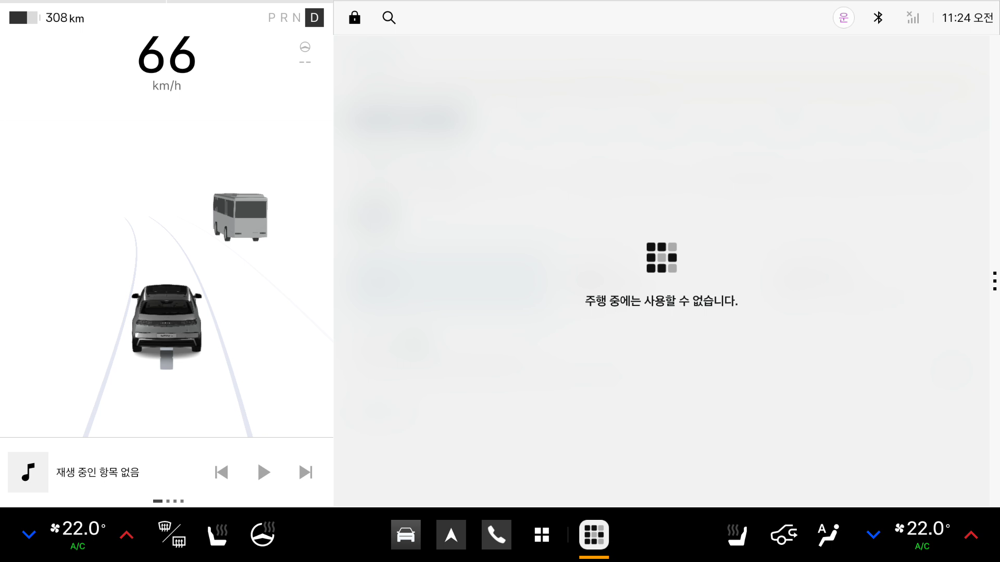
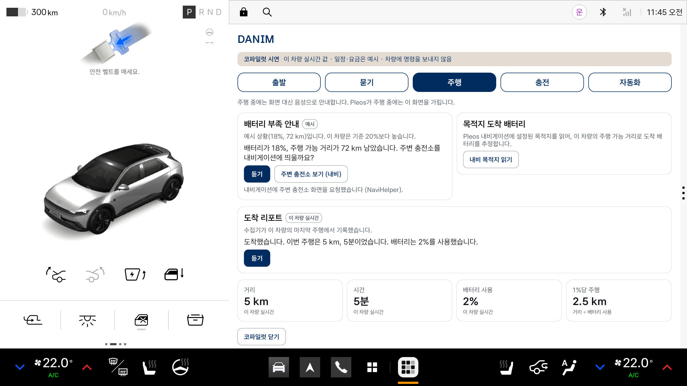
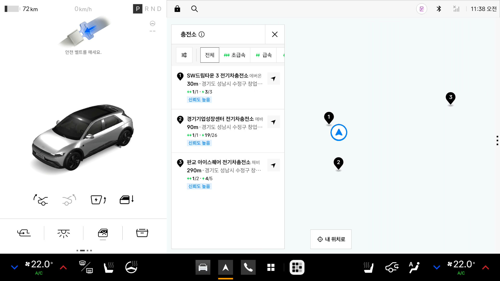
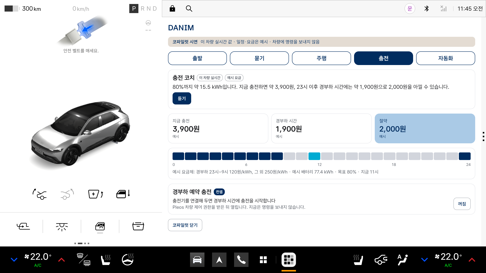
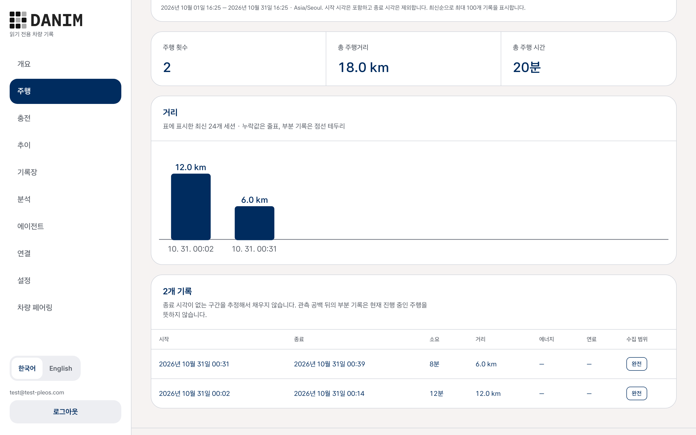
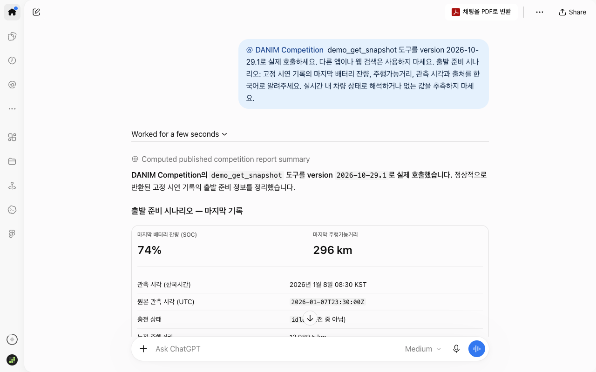

# 2. 사용자 경험

## 누구의 어떤 순간인가

운전자와 동승자가 차에서 궁금한 것은 숫자가 아니라 답입니다. "오늘 일정, 충전 없이 다녀올 수 있나?", "언제 충전하는 게 싼가?", "방금 주행에 배터리를 얼마나 썼나?" 이 질문은 차 안에서 생기지만, 답은 차량 화면·제조사 앱·충전 영수증·메모에 흩어져 있고 운전 중에는 화면을 볼 수 없습니다.

기존 차량 기록 서비스는 운전자가 휴대폰을 열어 찾아보는 대시보드입니다. DANIM은 반대로 기록이 차 안에서 먼저 말을 겁니다.

## 전기차 오너의 하루

장면마다 공식 Virtual Console로 차량 값을 바꿔 각각 확인했기 때문에 배터리 수치는 장면 사이에 이어지지 않습니다. [확인]·[예시]·[컨셉]의 뜻은 [1번 문서](01-app-development-ui-ux.md)와 같습니다.

### 아침, 출발 전 (주차)

코파일럿에서 '듣기'를 누르면 지금 배터리와 주행 가능 거리, 오늘 판교 미팅 왕복 62 km를 충전 없이 다녀올 수 있는지, 다음 정비를 음성으로 들려줍니다.
[확인: 차량 값은 Vehicle SDK, 음성은 Pleos TTS / 예시: 일정]

### 출발 전 질문

마이크를 누르고 "이번 주 얼마나 탔어?"라고 묻자 화면에 인식된 문장이 뜨고, 주행 횟수와 거리를 음성으로 답합니다.
[확인: Pleos STT가 에뮬레이터의 가상 마이크로 들어온 음성을 인식 / 주간 기록은 고정 시연 기록]

### 주행

속도가 오르면 Pleos가 앱 화면을 가리고, DANIM은 화면 없이 기록을 계속합니다.
[확인: Virtual Console 가상 주행 5 km 동안 화면이 가려진 채 수집이 계속됨]

### 도착

P단에 넣자 조작 없이 "도착했습니다. 이번 주행은 5 km, 5분이었습니다. 배터리는 2%를 사용했습니다."라고 말합니다.
[확인: 가상 주행 동안 수집기가 읽은 주행거리계·배터리 값으로 계산]

### 배터리가 부족해진 날

배터리가 18%가 되자 잔량과 주행 가능 거리를 먼저 말하며 주변 충전소를 띄울지 묻고, 정차 상태에서 '주변 충전소' 버튼을 누르면 Pleos 내비게이션의 충전소 목록이 열립니다.
[확인: 정차 상태에서 배터리 값을 18%로 바꿔 TTS와 NaviHelper 확인. 주행 중 말로 답하는 흐름은 Gleo 연동 이후 단계]

### 저녁, 충전

충전 코치가 "80%까지 약 15.5 kWh, 지금 충전하면 약 3,900원, 23시 이후 경부하 시간에는 약 1,900원"이라고 비교해 줍니다.
[확인: 배터리 60% 조건에서 계산과 음성 / 예시: 요금제·배터리 용량 / 컨셉: 예약 충전 실행]

### 집에서

주행과 충전은 Danim.app에 자동 기록으로 남습니다(2026-10-30 에뮬레이터 하루 시나리오에서 주행 2건·충전 1건이 차량 앱 → 서버 → 웹으로 기록되는 것을 확인).

주말에는 ChatGPT·Claude에 "이번 주 주행과 충전비 정리해줘"라고 물어 주행 89.5 km, 충전비 17,000원과 계산 근거를 받습니다(공개 시연 MCP의 고정 기록, 두 AI 모두 실제 호출로 확인). 오너는 Danim.app에서 AI별·차량별 접근을 허용하고 언제든 철회합니다.

## 경험을 지키는 규칙

- 차가 먼저 말하는 것은 두 가지뿐입니다: 도착 리포트와 배터리 부족 안내(기준을 넘는 순간 1회).
- 출발 브리핑은 '듣기'를 눌렀을 때만 말합니다.
- 답은 차량이 보고한 값과 내 기록에서 계산한 문장이고, 없는 값은 "알 수 없음"입니다.
- 일정과 요금제는 '예시', 자동화는 '컨셉'으로 화면에 표시됩니다.

## 영상으로 보기

[`demo/DANIM-demo-20261110.mp4`](../demo/DANIM-demo-20261110.mp4) (4분 17초). 차량 구간의 음성은 에뮬레이터에서 나온 Pleos TTS 출력을 그대로 녹음한 것이고, 질문 음성은 에뮬레이터의 가상 마이크에 재생한 합성 음성입니다.
